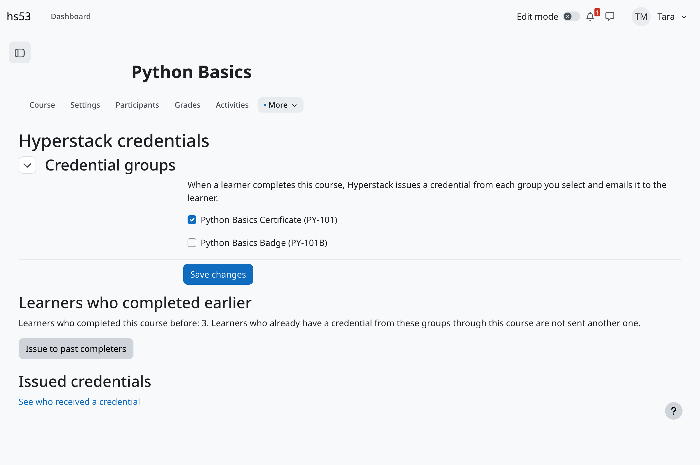
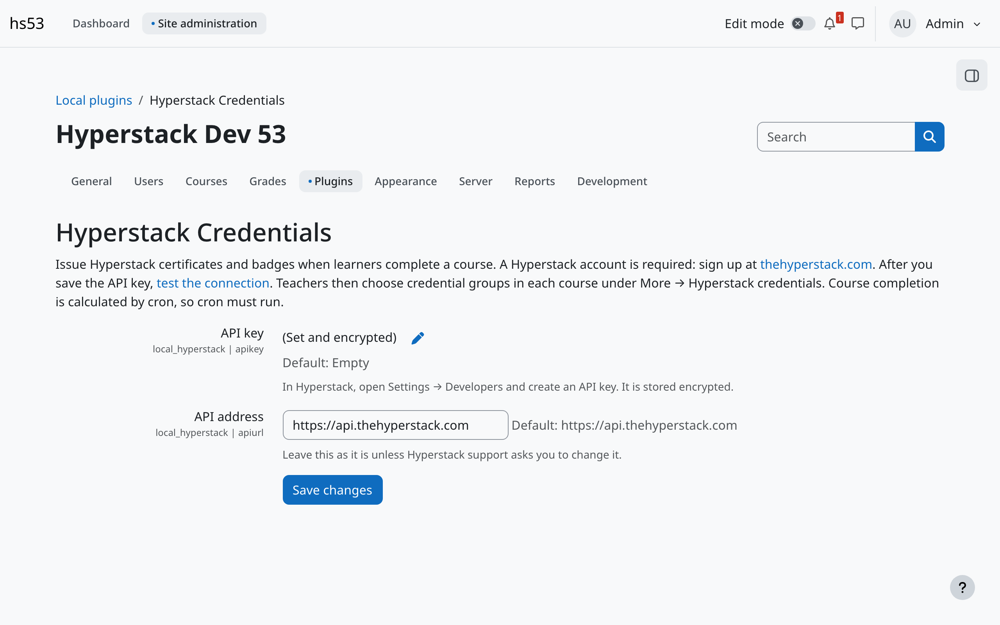
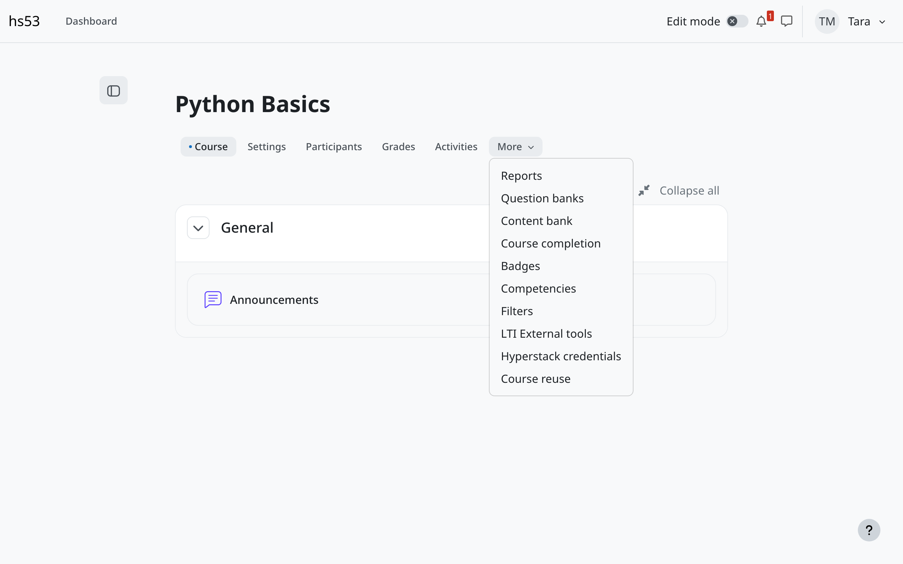
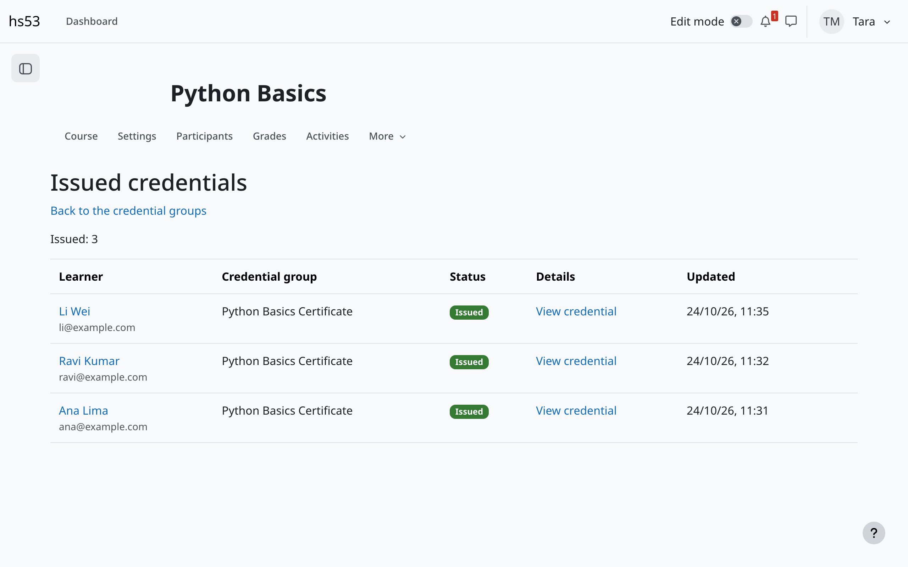

# Hyperstack Credentials for Moodle

Issue [Hyperstack](https://thehyperstack.com) certificates and badges automatically when learners complete a Moodle course.

- Teachers choose one or more Hyperstack credential groups for a course.
- When a learner completes the course, Hyperstack issues the credential and emails it to the learner.
- Learners who completed the course before can get theirs with one click.
- A course report shows who received what, and why a credential was not sent.

Plugin name: `local_hyperstack`. Supports Moodle 4.5 to 5.3 (PHP 8.1 to 8.4).

**A Hyperstack account is required.** Hyperstack's free plan covers up to 20 recipients; larger volumes need a Hyperstack plan.

## Install

From the Moodle Marketplace, or by hand:

1. Download the zip of the latest release.
2. In Moodle, go to **Site administration → Plugins → Install plugins** and upload it. Or unzip it into `local/hyperstack` (Moodle 5.1 and later: `public/local/hyperstack`).
3. Complete the upgrade when Moodle asks.

## Set up

### 1. Connect the site (site administrator)

1. In Hyperstack, open **Settings → Developers** and create an API key.
2. In Moodle, go to **Site administration → Plugins → Local plugins → Hyperstack Credentials**.
3. Paste the key in **API key** and save. Moodle stores it encrypted.
4. Click **test the connection**. You see your Hyperstack account name and credit balance.

### 2. Choose a course's credential groups (teacher)

1. Make sure the course has **completion tracking** on and **course completion conditions** set (**More → Course completion**).
2. In the course, open **More → Hyperstack credentials**.
3. Select the credential groups to issue, and save.
4. Learners who completed the course before? Click **Issue to past completers**.

### 3. Follow what was issued

**Hyperstack credentials → See who received a credential** lists every learner with the status, a link to the credential, and **Retry** for anything that was not sent.

## How it works

- Moodle works out course completion in a scheduled task (**Calculate regular completion data**), so **cron must run**. Credentials go out a few minutes after a learner completes the course.
- Each completion queues a background task that calls the Hyperstack API. Moodle's page is never slowed down.
- A learner gets a credential from the same course and group only once.
- If Hyperstack cannot be reached, or the account has no credits left, Moodle tries again later with a growing delay. A refused call (for example a wrong API key) stops at once and shows the reason on the course report.
- Suspended and deleted learners are skipped.
- Course backups, copies and restores keep the course's credential groups. Issue records are not copied.
- Teachers and managers have the capability `local/hyperstack:manage` by default.

## Privacy

To issue a credential, the plugin sends the learner's **full name** and **email address** to Hyperstack, which creates the credential and emails it to the learner. The plugin keeps, for each learner, course and group, whether the credential was issued. The Moodle privacy API exports and deletes these records. Credentials already issued stay in Hyperstack; manage them there. See the [Hyperstack privacy policy](https://thehyperstack.com/privacy-policy).

## Support

- Questions: [hello@thehyperstack.com](mailto:hello@thehyperstack.com)
- Bugs and requests: [GitHub issues](https://github.com/hyperstack/moodle-local_hyperstack/issues)
- Guide: [thehyperstack.com/docs](https://thehyperstack.com/docs/integrations/moodle-plugin)

## Development

Tests: PHPUnit and Behat, run by [moodle-plugin-ci](https://github.com/moodlehq/moodle-plugin-ci) on GitHub Actions for Moodle 4.5 and 5.3 with PostgreSQL and MariaDB.

## Licence

Copyright 2026 Hyperstack Inc.

GNU GPL v3 or later. See [LICENSE](LICENSE).
